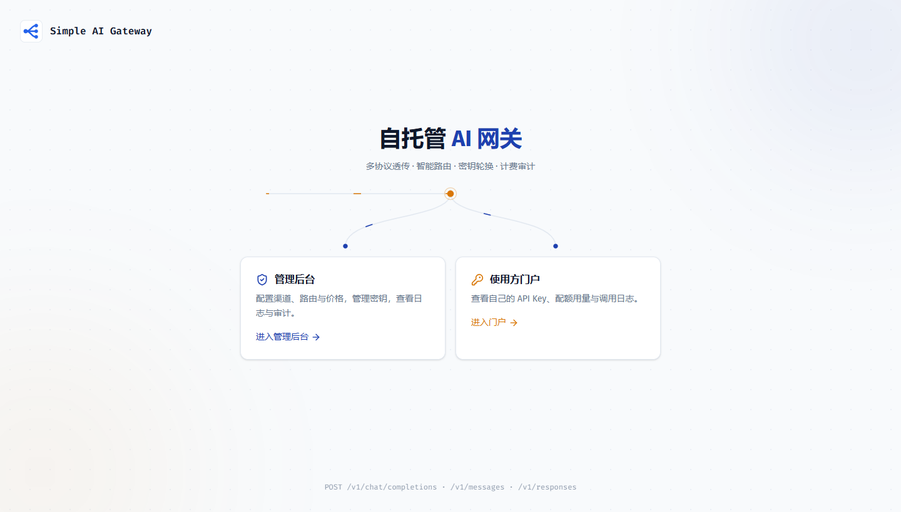
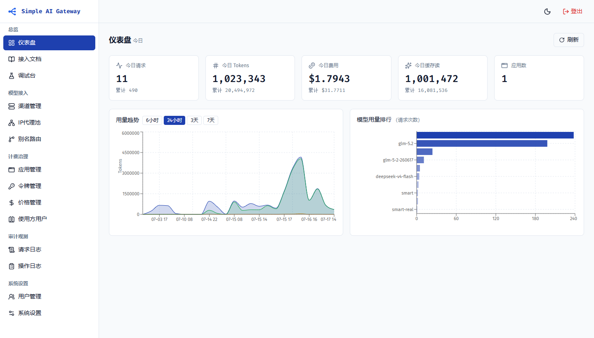
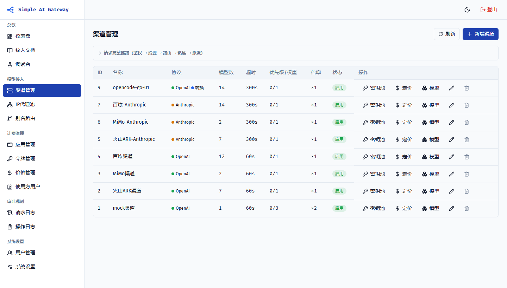
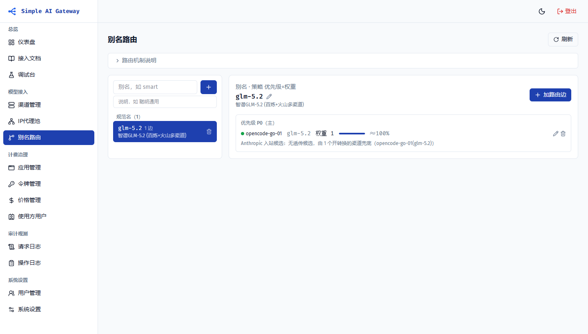
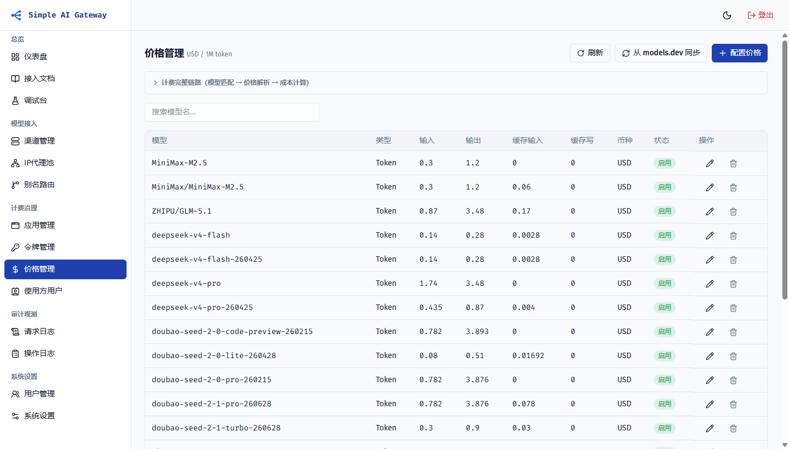
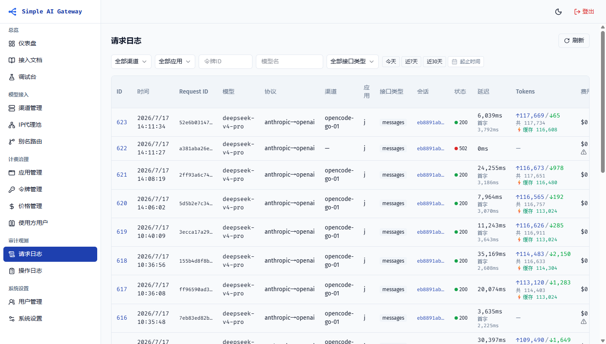
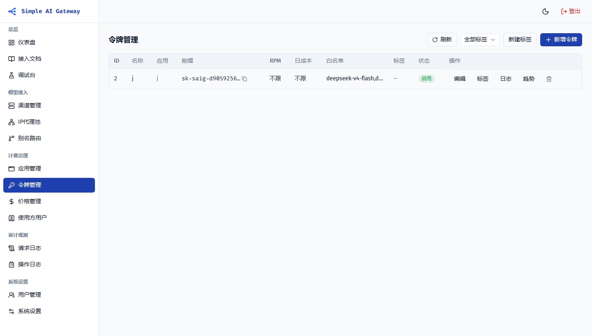
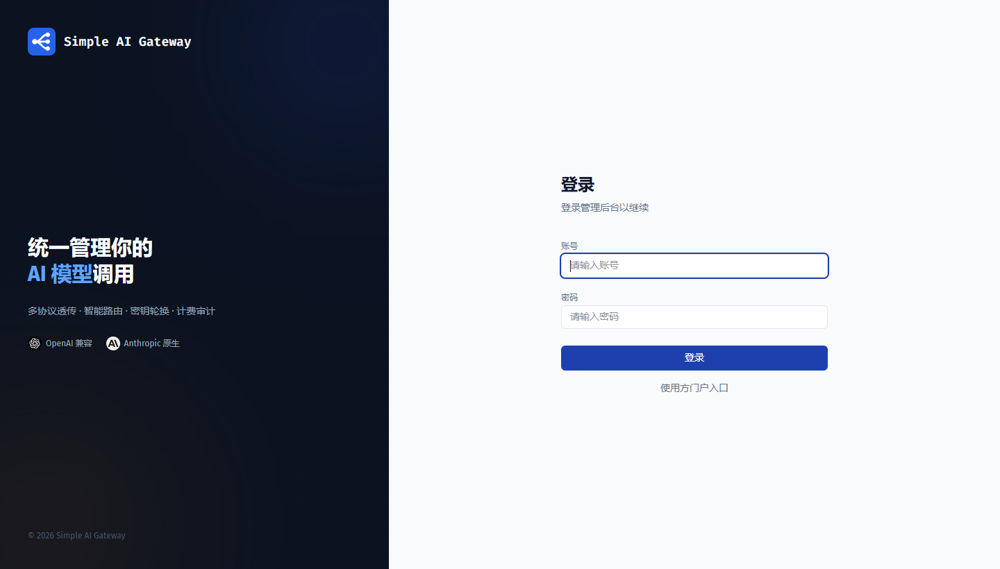

# simple-ai-gateway

**English** | [简体中文](README.zh-CN.md) | [日本語](README.ja.md)

[](https://github.com/ruanun/simple-ai-gateway/actions/workflows/ci.yml)
[](https://github.com/ruanun/simple-ai-gateway/actions/workflows/security.yml)
[](LICENSE)

> Enterprise-grade self-hosted AI gateway: protocol-preserving passthrough across OpenAI, Anthropic, and Responses APIs, three-tier intelligent routing, multi-key channel pools + IP proxy failover, forensic-grade audit replay, and fine-grained billing and quotas — packaged as a single binary with no external dependencies by default.

`simple-ai-gateway` is a self-hosted AI gateway for teams and enterprises. The backend is Go + Gin with a pure-Go SQLite driver by default (no cgo), so it starts with one command and requires no external middleware. The frontend is React 19 + shadcn/ui, compiled into the **single executable** (static assets are embedded).

It focuses on **upstream aggregation + billing + multi-tenant distribution + auditing**: it brings official APIs and subscription-to-API upstream projects such as [CLIProxyAPI](https://github.com/router-for-me/CLIProxyAPI) and [sub2api](https://github.com/Wei-Shaw/sub2api) under one roof for management, billing, and distribution. Subscription access itself (OAuth takeover, ban avoidance) is left to specialized upstream projects — once they expose subscriptions as OpenAI/Anthropic-compatible endpoints, register them as an ordinary channel here; availability is covered by channel failover/degradation.

> Detailed docs under `docs/`, plus `CONTRIBUTING.md` and `SECURITY.md`, are currently in Simplified Chinese.



## Highlights

- **Multi-key channel pools + IP proxy failover**: multiple upstream keys per channel; accounts can bind proxy groups; rotation by priority + weight + health; independent circuit breakers at account and proxy level. "Account + IP dual-channel rotation" spreads rate limits and automatically switches away from single points of failure.
- **Multi-protocol, same-protocol passthrough**: OpenAI `/v1/chat/completions`, Anthropic `/v1/messages`, and OpenAI Responses `/v1/responses` preserve the inbound protocol outbound (tool_use / thinking / streaming SSE compatible). Native toolchains such as Claude Code / Codex CLI connect without changes; each channel can optionally enable a chat↔messages **protocol-conversion fallback**.
- **Three-tier intelligent routing + session affinity**: channel → account → model routing; aliases are layered by priority (failover) and weighted-random within a layer (load balancing); a session sticks to the same account to reuse upstream prompt cache, and automatically escapes unhealthy accounts.
- **Forensic-grade audit replay**: raw request/response bodies are written asynchronously to a storage backend (local directory or S3; never to the database; the request path is not blocked). Request-log details replay the full input/output, including full-body SHA-256 integrity hashes, with header redaction, retention cleanup, and a per-app toggle.
- **Fine-grained billing and quotas**: integer micro-USD pricing (1 USD = 1,000,000 micros); itemized price table (input/output/cache read/cache write); one-click official price sync from models.dev; **per-channel price overrides + channel multipliers** for discounted resale; apps are the quota principal with shared team budgets, plus per-key daily cost caps / model allowlists / model mappings.
- **Consumer portal + RBAC**: self-service portal for API consumers (view quotas, create keys, inspect logs; generic OIDC third-party login); admin roles super admin / operator / read-only; Chinese/English toggle in the top bar (navigation, login, dashboard, channels/keys/apps/prices/aliases/logs/settings/channel health, portal, and playground are localized; the integration docs body and some long-form help text remain in Chinese).
- **Resilience with zero dependencies**: in-process rate limiting and circuit breaking work out of the box; multi-instance deployments can use Redis for shared state and Pub/Sub hot-reload of routes and prices.

## UI preview

| Dashboard | Channel management |
|:---:|:---:|
|  |  |

| Alias routing | Pricing |
|:---:|:---:|
|  |  |

| Request logs | API keys |
|:---:|:---:|
|  |  |

| Login |  |
|:---:|:---:|
|  |  |

## Feature overview

| Module | Capabilities |
| --- | --- |
| Multi-protocol passthrough | `/v1/chat/completions`, `/v1/messages`, and `/v1/responses` same-protocol passthrough (only credentials are replaced and the model is rewritten); `/v1/messages/count_tokens` and `/v1/responses/input_tokens` free token counting; `/v1/embeddings`, `/v1/images/generations` (per-call billing), and `/v1/models`; channel-level chat↔messages conversion fallback (always ordered after passthrough candidates) |
| Intelligent routing | Channel → account → model; alias routing (priority tiers + weighted random); direct real-model routing; in-memory route table with hot reload; retry with another account within a channel + cross-channel degradation |
| Session affinity | Same session sticks to the same account (prompt-cache affinity, 5-minute sliding window); Anthropic uses `metadata.user_id`, Responses uses `previous_response_id`, Chat derives it from a client fingerprint; unhealthy accounts are escaped automatically |
| Rate limiting & circuit breaking | API-key + channel + account RPM limits; account in-flight concurrency cap; independent circuit breakers for channel / account / proxy (failure-rate window + 429 cooldown) |
| Key pool | Multiple upstream keys (accounts) per channel; credentials AES-encrypted and stored on accounts; priority + weight + health rotation; account concurrency/RPM/expiry/temporary disable/rate-limit and overload cooldown |
| IP proxy pool | Accounts bind proxy groups; HTTP / HTTPS / SOCKS5 egress; weighted proxy rotation + proxy-level circuit breaker; works with the key pool for "account + IP dual-channel rotation" |
| Billing & quotas | Integer micro-USD pricing; itemized price table (token items / per call); channel override → global price two-level resolution × channel multiplier; models.dev official price sync; app quota (402) + per-key daily cost cap (402, resets next day); in-flight quota reservation before the request and settlement against actual cost after the response; daily / hourly usage aggregation |
| Idempotency & retries | Non-streaming `/v1` requests support `Idempotency-Key`: same key + same body replays the cached response without double billing; different body returns 409; streaming requests are explicitly rejected |
| Key governance | Model mapping (request model rewrite), model allowlist (403), RPM limiting, tags |
| Audit & observability | Request logs (protocol/channel/session/first-token latency/token breakdown/cost); details embed forensic audit replay (full bodies async to local directory / S3 + redaction + SHA-256 integrity + retention cleanup); admin operation logs; channel health (success rate/error rate/weighted latency/first token); `/healthz`, `/readyz`, Prometheus `/metrics` |
| Portal & permissions | Consumer portal (self-service quota/key/log access); registration toggle; generic OIDC third-party login; admin RBAC (super admin/operator/read-only) |
| Error governance | Per-channel error passthrough toggle: on total candidate failure, preserve the last upstream status code and redacted message; by default return a public summary without internal topology |
| Outbound governance | Unified outbound header governance (allowlist backfill without forgery + custom-header guard + Anthropic auth header styles auto/x-api-key/bearer/both) |
| Data & deployment | SQLite (default) / MySQL / PostgreSQL; optional Redis (shared rate limiting/circuit breaking/session affinity + Pub/Sub hot reload); single-binary deployment; SQLite online backup/restore (`--backup` / `--restore`) |

## Quick start

**1. Prepare the configuration (required)**. If `jwt.secret`, `security.channel_key_aes_key`, or `admin.password` is still the built-in default or empty, the process **refuses to start** (this prevents a default deployment from being taken over).

```bash
cp config.example.yaml config.yaml     # template at the repo root; three REQUIRED items
openssl rand -hex 32       # → jwt.secret
openssl rand -hex 16       # → security.channel_key_aes_key (32 hex chars = 32 bytes)
openssl rand -base64 18    # → admin.password (seeded on first start; change it later in the console)
```

**2. Start it**, choose one:

```bash
# Option 1: single binary (download the tar.gz / zip for your platform from Releases, or build locally)
sh scripts/build.sh && ./server -c config.yaml

# Option 2: Docker (images support linux/amd64 and linux/arm64)
docker run -d -p 8080:8080 -e TZ=Asia/Shanghai -v saig-data:/app/data \
  -v ./config.yaml:/app/config.yaml:ro \
  ghcr.io/ruanun/simple-ai-gateway:latest

# Option 3: run from source (Go 1.26+ / pnpm; build the frontend first, go:embed needs web/dist)
cd web && pnpm install && pnpm build && cd .. && go run ./cmd/server -c config.yaml
```

> Docker Hub mirror: `docker.io/ruanun/simple-ai-gateway:latest`, with the same arguments as the GHCR command above. GHCR/Docker Hub images and Release archives are produced by the `v*` tag Release workflow; if `latest` is not available yet, build locally with option 1 or 3.

Open `http://localhost:8080` and log in as `admin` with the password you set in `admin.password`. Data is stored in `data/saig.db` by default.

Once a channel is configured, verify the path with curl:

```bash
curl http://localhost:8080/v1/chat/completions \
  -H "Authorization: Bearer sk-saig-xxxxxxxx" \
  -H "Content-Type: application/json" \
  -d '{"model": "gpt-4o", "messages": [{"role": "user", "content": "Hello"}]}'
```

**→ Full onboarding path: [docs/快速开始.md](docs/快速开始.md)** (start → add a channel → set prices → create a key → connect Claude Code / Codex CLI). The linked guide is currently in Chinese.

## Deployment

- **Single instance**: one binary + SQLite, with no external dependencies (rate limiting / circuit breaking / session affinity use in-process implementations with no feature loss).
- **Docker / docker-compose**: the repo-root `docker-compose.yml` works after you uncomment the `./config.yaml:/app/config.yaml:ro` mount line (without it, the built-in default credentials are rejected by the startup guard), then run `docker compose up -d`. Set `TZ` (it controls daily cost limits and usage-aggregation day boundaries).
- **Reverse proxy**: forward `Host` / `X-Forwarded-Proto` (the OIDC callback URL is configured explicitly in System Settings), disable response buffering for `/v1/*` (so SSE is not batched), and put the proxy address in `server.trusted_proxies` in `config.yaml` (otherwise the gateway ignores `X-Forwarded-For` and all users share one login rate-limit bucket).
- **Multi-instance**: MySQL/PG + Redis (shared rate limiting/circuit breaking/session affinity; Pub/Sub broadcasts route and price hot reloads).

**→ systemd / Nginx examples, the full configuration reference, backup, and the hardening checklist are in [docs/部署指南.md](docs/部署指南.md).** The linked guide is currently in Chinese.

## Protocol access

| Inbound endpoint | Client protocol | Outbound | Suitable tools |
| --- | --- | --- | --- |
| `POST /v1/chat/completions` | OpenAI Chat | passthrough to `type=openai` channels | Cursor, Continue, generic OpenAI SDK |
| `POST /v1/messages` | Anthropic Messages | passthrough to `type=anthropic` channels (supports `x-api-key` / `Bearer`) | Claude Code, Claude SDK |
| `POST /v1/responses` | OpenAI Responses | passthrough to `type=openai` channels | Codex CLI, OpenAI Agents SDK |
| `POST /v1/embeddings` | OpenAI Embeddings | forwarded | embedding calls |
| `POST /v1/images/generations` | OpenAI Images | forwarded (per-call billing) | image generation |
| `GET /v1/models` | OpenAI Models | local model list | — |

> **One protocol per channel**: a channel's protocol is `Channel.Type`. If an upstream exposes both protocols, create one channel per protocol. With channel protocol conversion enabled, requests using the other protocol can fall back through chat↔messages conversion (conversion candidates always come after same-protocol passthrough candidates).

The admin console includes an **Integration Docs** page with detailed setup steps for Claude Code / Codex CLI / Cursor and other tools; share it directly with consumers.

## Tech stack

- **Backend**: Go 1.26 + Gin + GORM (`glebarez/sqlite` pure-Go driver, no cgo); JWT auth; AES-encrypted upstream credentials
- **Frontend**: React 19 + Vite + TypeScript; Tailwind CSS v4 + shadcn/ui (Radix primitives); TanStack Query; Recharts
- **Design**: primary blue `#1E40AF` + amber accent `#D97706`, with light and dark themes

## Directory layout

```
simple-ai-gateway/
├── cmd/server/            # entrypoint
├── internal/
│   ├── config/            # config loading (YAML + defaults)
│   ├── db/ · model/       # DB connection, GORM models and migrations (idempotent by ID)
│   ├── domain/            # business domains
│   │   ├── gateway/       #   gateway core: multi-endpoint orchestration / dispatch / billing / key selection
│   │   ├── channel/ account/ alias/ apikey/ app/ price/ proxy/
│   │   ├── requestlog/ usage/ keytag/ setting/ cleanup/
│   ├── router/            # in-memory route table (hot reload via Pub/Sub)
│   ├── convert/ v1proto/  # chat↔messages conversion, /v1 dual-protocol error envelope
│   ├── ratelimit/ breaker/ session/   # rate limiting / circuit breaking / session affinity (memory and Redis)
│   ├── accountpick/ proxypick/ proxydial/  # key-pool and proxy selection, proxy dialing
│   ├── audit/             # forensic audit (async write / replay / cleanup)
│   ├── storage/           # audit body storage abstraction (local / s3)
│   ├── billing/ backup/ ipgeo/ crypto/ redis/
│   ├── middleware/ admin/ portal/     # auth/rate-limit middleware, admin API, consumer portal API
│   └── server/            # single dependency assembly point: routes + embedded frontend
├── web/                   # React frontend (admin + portal + landing)
├── tools/                 # local test processes (mock upstream / test proxy)
├── scripts/build.sh       # frontend → backend build order
└── docs/                  # documentation and design notes
```

## Configuration

The config file is passed with `-c` and defaults to `config.yaml` in the current directory; unlisted options use built-in defaults. Leaving the three REQUIRED items at their defaults or blank makes the process **refuse to start**:

| Option | Description | Default |
| --- | --- | --- |
| `server.port` | listen port | `8080` |
| `server.trusted_proxies` | trusted reverse-proxy IP/CIDR; when empty, only the TCP peer is trusted | `[]` |
| `database.driver` / `dsn` | `sqlite` / `mysql` / `postgres` and connection string | `sqlite` / `data/saig.db` |
| `database.max_open_conns` etc. | connection-pool parameters | driver defaults |
| `redis.enabled` / `addr` | shared state for multi-instance deployments (not needed for a single instance) | `false` |
| `admin.username` / `password` | super-admin account (seeded on first start only; change the password later in the console) | `admin` / **REQUIRED** |
| `jwt.secret` / `expire_hours` | admin JWT signing secret | **REQUIRED** / `24` |
| `security.apikey_prefix` | API key prefix | `sk-saig` |
| `security.channel_key_aes_key` | AES key for upstream credentials; **must be 16/24/32 bytes**, otherwise startup is refused | **REQUIRED** |
| `log.level` / `format` / `output` | process logs: level, text/json, stderr/stdout/file | `info` / `text` / `stderr` |

Full template: repo-root `config.example.yaml`; common options: [docs/部署指南.md](docs/部署指南.md#配置参考) (Chinese).

## Documentation

| Document | Contents |
| --- | --- |
| [docs/快速开始.md](docs/快速开始.md) | 10-minute path: start → add a channel → first request → connect tools |
| [docs/部署指南.md](docs/部署指南.md) | binary / Docker / reverse proxy / multi-instance / backup / hardening |
| [docs/使用手册.md](docs/使用手册.md) | core concepts, admin page-by-page guide, consumer portal, FAQ |
| [docs/UI设计规范.md](docs/UI设计规范.md) | frontend colors and component conventions |

> These guides are currently in Simplified Chinese.

## Author and license

- Author: **ruanun**
- License: [Apache License 2.0](LICENSE)
- Contributing: read [CONTRIBUTING.md](CONTRIBUTING.md) first, especially the commit-email convention
- Security disclosure: do not post credentials or unfixed vulnerabilities in public issues; report privately via [SECURITY.md](SECURITY.md)
